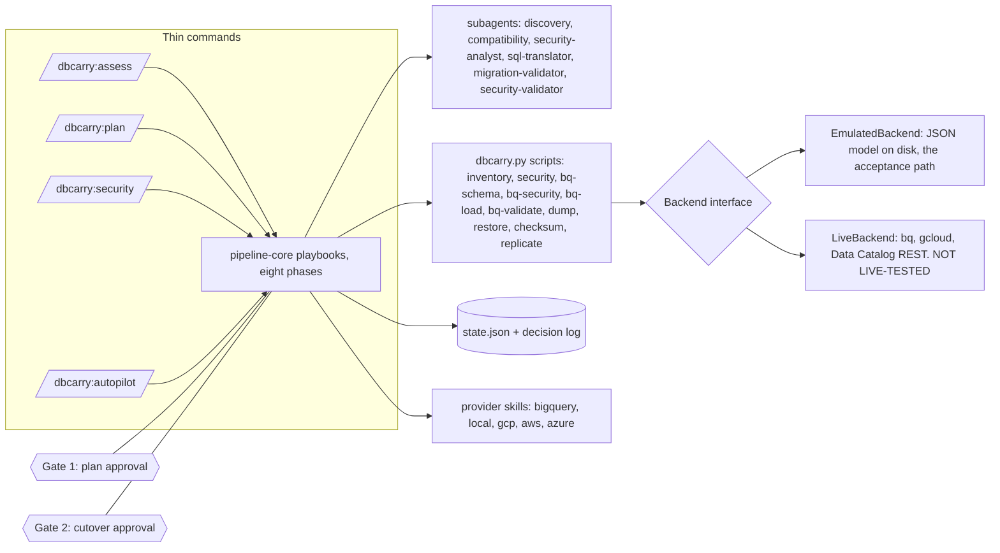

# dbcarry

> **This repository is an example, offered to foster ideas or to take and
> adapt. It exists to show how a frontier AI model can carry work that has
> historically been human-centric and time-consuming: here, migrating a
> PostgreSQL database to BigQuery with its security controls intact, from
> discovery through cutover, with the model doing the reading, planning,
> and checking and a human approving the two gates. It is built for
> [Claude Code](https://claude.com/claude-code): the commands, subagents,
> and skills below only run inside it. Treat it as a starting point, not a
> product; the BigQuery path is proven against an emulator, not a live
> project.**

dbcarry migrates an on-prem PostgreSQL database to a cloud target. Version
0.2.0 adds Google BigQuery as a target and makes **security parity** the
distinguishing feature: the pipeline reads the roles, grants, column
privileges, and row-level security policies that exist on the PostgreSQL
source, plans the equivalent BigQuery controls (IAM bindings, Data Catalog
policy tags for column-level security, row access policies for row-level
security), applies them to empty tables before any data lands, and then
reads every control back from the target to verify it. A thin set of slash
commands drives a deterministic state machine through eight phases with two
mandatory human approval gates. Nothing about the data plane or the security
plane is left to a model's judgment: row counts, fingerprints, bindings,
tags, and policies are computed by code and compared by code.

The whole pipeline runs on a laptop with no GCP account through an
**emulated BigQuery backend**, which is what the acceptance run below
exercises. The live backend shells out to `bq` and `gcloud` and is written
from their documentation and mock-tested; it is **NOT LIVE-TESTED**, because
no GCP credentials existed where this was built. That distinction is
repeated wherever it matters in this README and in `docs/HANDOFF.md`.

## Architecture



Each command is a thin router into `skills/pipeline-core`, which holds the
shared rules and the per-phase playbooks. A playbook dispatches a subagent
when the work needs judgment (narrating a security inventory, resolving a
SQL translation the rule-based translator flagged, trying to break a
finished migration) and calls a script when the work needs to be exact (a
security inventory, a policy plan, a load, a read-back verification). The
BigQuery scripts talk to a `Backend` interface with two implementations:
`EmulatedBackend` keeps a JSON model and the loaded NDJSON under
`~/.dbcarry/bq-emulated/<migration>/` and enforces the structural rules the
pipeline relies on (a tagged column is readable only with the fine-grained
reader role, a table with any row access policy denies principals no policy
names); `LiveBackend` renders the same operations as `bq` and `gcloud`
commands plus three Data Catalog REST calls. Every phase transition and gate
decision is written to `state.json` and `decision-log.md` by the state CLI,
never by hand, and a PreToolUse hook refuses hand edits mechanically.

## The pipeline

| Phase | What it does (BigQuery target) | Artifact |
|---|---|---|
| init | Creates the migration workspace, records source connection details and the `bigquery` block (mode, project, location, dataset map, principal map path) | `migration.yaml` |
| assess | Dispatches discovery, compatibility, and security-analyst subagents; the security inventory is read-only catalog queries; writes the principal-map template the operator fills in | `01-assessment.md`, `inventory.json`, `inventory-notes.md`, `compatibility-notes.md`, `security.json`, `security-notes.md`, `security/principal-map.yaml` |
| plan | Strategy `bulk_load` by rule, schema translation, the security plan, review items for the sql-translator subagent, then **Gate 1** showing unmapped roles, every WARNING, and every translation resolution | `02-plan.md`, `schema-plan.json`, `security-plan.json`, `security-plan.md`, `translation-review.json`, `bq-apply/` |
| provision | Creates the datasets through the backend (`bq-schema apply --datasets-only`) | `03-provision.md`, `target.json` |
| migrate_schema | Creates tables and views from the translated DDL, then verifies by listing: counts equal the plan | `04-schema-report.md`, `schema-applied.json`, `schema-verify.json` |
| migrate_security | Applies IAM bindings, the enforced taxonomy and its policy tags, column tag attachments, and row access policies to the still-empty tables; reads everything back and fails on any miss. Postgres targets: role sync plus a security diff | `04b-security-report.md`, `security-applied.json`, `security-verify.json` |
| migrate_data | Exports every table as NDJSON (read-only), loads it, compares loaded counts with exported counts | `05-data-report.md`, `load-report.json`, `export/` |
| validate | Dispatches migration-validator with engine-neutral fingerprints and security-validator with the probe set; both verdicts must pass | `06-validation.md`, `fingerprint-source.json`, `fingerprint-target.json`, `fingerprint-compare.json`, `06b-security-validation.md`, `security-probes.json` |
| cutover | Presents **Gate 2**, then quiesces the source, re-reads the source counts and compares them with the loaded counts (reload of drifted tables), runs smoke fingerprints (`bq-validate`) against the target | `07-cutover-runbook.md`, `cutover-source-fingerprint.json`, `cutover-target-fingerprint.json`, `cutover-fingerprint-compare.json` |

The Postgres to Postgres path from v0.1.0 keeps working (dump_restore and
logical_replication strategies, checksums, sequence bumps). It gains the
`migrate_security` phase too: `security sync-roles` recreates role
attributes and memberships that `pg_dump` does not carry, and `security diff`
proves grant and policy parity between the two sides.

`migrate_security` runs before `migrate_data` on purpose. A table that is
populated before its policy tags and row access policies exist is a window
of exposure, and the pipeline never opens that window; in live mode
`bq-load` refuses to load until `security-verify.json` records a pass.

## Quickstart (emulated, no GCP account)

```
# install the plugin, then from your project directory:
/dbcarry:demo setup
/dbcarry:init demo-bq      # answer: provider bigquery, mode emulated, demo source defaults
/dbcarry:autopilot
```

`/dbcarry:demo setup` seeds a local "on-prem" PostgreSQL 17 instance with
a 655,000-row retail schema (customers, products, orders, order_items,
audit_log, a view, a materialized view) plus the planted security findings
listed in `demo/scenario.md`: row-level security on `orders` and
`audit_log`, a column-level grant that restricts `customers.email`, a role
membership, a default-privileges rule, and a superuser owner.
`/dbcarry:init` writes the workspace. After assess writes
`security/principal-map.yaml`, fill in one principal per role (any
`group:` address works in emulated mode) before approving Gate 1; a role
left empty is reported as unmapped and receives no bindings, which is the
deny-by-default outcome, not an error. `/dbcarry:autopilot` runs every
phase in order, pausing only at the two gates.

Acceptance run of the emulated demo through cutover (every number below is
from **emulated mode**, which proves pipeline logic and export fidelity,
not BigQuery's behavior):

Workspace `sandbox/release/migrations/bq-demo`, run on 2026-09-09 against
a freshly reseeded demo source (PostgreSQL 17.5, 655,000 rows). Phase
timings from the decision log (all emulated):

| Phase | Wall time | What happened |
|---|---|---|
| assess | 5 min 30 s | three subagents, principal-map template, schema translate: 0 WARNING, 3 INFO, 4 NOTE |
| plan (Gate 1) | 1 min 34 s | bulk_load; 12 bindings, 1 policy tag, 5 row access policies, 1 authorized view; 0 items at review, no resolutions needed |
| provision | 18 s | dataset `retail` created and read back (a stale emulator directory from an earlier sandbox run failed the first attempt; reset and re-run, both recorded in the decision log) |
| migrate_schema | 22 s | 5 tables, 1 view, 1 materialized view applied; SCHEMA VERIFY PASSED (5 tables, 2 views) |
| migrate_security | 29 s | 22 operations applied on empty tables; SECURITY VERIFY PASSED, 23 checks, enforcement_active true |
| migrate_data | 43 s | `bq-load run`: 655,000 rows exported and loaded in 14.3 s |
| validate | 6 min 1 s | migration-validator and security-validator in parallel; both verdicts PASSED |
| cutover (Gate 2) | 1 min 8 s | quiesce, delta check, smoke fingerprints, staging removed |

Exported and loaded per table (emulated; exported equals loaded on every
row): audit_log 50,000; customers 100,000 (policy tag on `email` kept
through the load); orders 200,000; products 5,000; order_items 300,000.

Verification results (emulated):

- Fingerprint compare (row count plus per-column aggregates on 22
  columns, 71 metrics): match true on all 5 tables, nothing missing on
  either side. The validator also proved the compare verb fails on a
  mutated copy and compared all 655,000 stored rows with the export row
  by row (0 differences).
- `bq-security verify`: 23 checks passed, 0 failed, enforcement_active
  true (taxonomy `dbcarry_bq-demo` activated for
  FINE_GRAINED_ACCESS_CONTROL).
- `bq-security probes --run`: 18 of 18 probes passed (15 row_count, 2
  column_denied, 1 column_allowed, 0 unevaluable). reporting read 66,750
  of 200,000 orders (source `region = 'eu'` count 66,750); app_ro read 0
  orders (no policy names it, as on the source); app_ro and reporting
  were denied `customers.email`; the two `SESSION_USER()` probes on
  audit_log were reported, not compared (identity predicate). Every
  attempted bypass (tagged column read, rows outside policy, unmapped
  role with a binding, allUsers anywhere, authorized view, column_allowed
  denied) found NO GAP.
- Cutover delta check: source row count minus loaded count was 0 on all
  5 tables after the quiesce; the cutover fingerprint compare matched on
  all 5 tables.

How the run was driven: the orchestrating Claude Code session executed
each phase playbook in order and dispatched five subagents where the
playbooks call for them (discovery-analyst, compatibility-checker, and
security-analyst in assess; migration-validator and security-validator in
validate). The sql-translator was not needed because nothing was flagged
for review. Both gates were presented in the main session with the plan
and the runbook; this being a sandbox run driven end to end on the
operator's standing instruction, the decision log records both approvals
as made by the orchestrating session. The run ended with a cutover against
the emulator, which left the demo source read-only.

The PostgreSQL-target security phase was proven in the same sitting in
workspace `sandbox/release/migrations/pg-parity` (provider local,
dump_restore, phases driven by script through migrate_data): after
`security sync-roles` (7 statements) and the pre-data restore, `security
diff` reported zero differences in roles, memberships, schema, relation
(107 rows), and column (3 rows) privileges, with the 2 RLS flags and 4
policies listed as missing exactly as the playbook predicts; after the
post-data restore the same diff reported match true in every section.

## Security parity

The mapping is one pure function, `plan_security` in
`scripts/db_carry/bq_security.py`, restated for humans in
`docs/security-mapping.md` (with the demo as the running example) and in
`skills/security-mapping/`. The compact version:

| PostgreSQL | BigQuery |
|---|---|
| Role | One principal from `security/principal-map.yaml` (`user:`, `group:`, or `serviceAccount:` recommended; `domain:` and `specialGroup:` accepted). An unmapped role gets a WARNING and nothing else |
| Role membership with INHERIT | Flattened: the member's principal receives the union of its own and its groups' privileges. NOINHERIT is flagged, not flattened |
| `PUBLIC` grants | Folded into every role; bound directly only when `public_principal` is set. Never `allUsers` or `allAuthenticatedUsers` |
| SELECT on a table, view, or matview | `roles/bigquery.dataViewer` on the relation; promoted to the dataset when the role holds it on every relation there (`binding_granularity: auto`) |
| INSERT, UPDATE, DELETE, TRUNCATE | `roles/bigquery.dataEditor` on the relation (a WARNING whenever the source lacked any of SELECT, INSERT, UPDATE, DELETE, since dataEditor grants all four) |
| USAGE on a schema with no relation grants | `roles/bigquery.metadataViewer` on the dataset |
| CREATE on a schema | `roles/bigquery.dataEditor` on the dataset, WARNING |
| Every principal that received a binding | `roles/bigquery.jobUser` on the project, once |
| Column-level SELECT | One policy tag per group of restricted columns under a taxonomy activated for `FINE_GRAINED_ACCESS_CONTROL`; each allowed role's principal gets `roles/datacatalog.categoryFineGrainedReader` on the tag |
| Row-level security policies | One row access policy per (table, mapped role) named `rls_<role>`, predicate `(permissive OR ...) AND (restrictive) ...`, translated by `bq_predicate` |
| RLS enabled, no policy applies to a role | No policy for that role; it sees no rows, as on PostgreSQL |
| RLS enabled and no mapped role gets a read policy (no policies at all, or policies naming only unmapped roles or only INSERT, UPDATE, DELETE commands) | `rls_deny_all` with `FILTER USING (FALSE)` to `admin_principal`, WARNING |
| Superuser, BYPASSRLS, or owner (RLS not forced) | `rls_bypass_<role>` with `FILTER USING (TRUE)`, only when mapped |
| A view readable by a role that cannot read every base table | Authorized view entry on the base dataset |
| Sequences, REFERENCES, TRIGGER, ownership, default privileges | Not mapped; INFO or NOTE |
| Column-level INSERT or UPDATE, INSERT/UPDATE/DELETE policies, WITH CHECK | No BigQuery equivalent; WARNING |

A predicate or view body the translator marks `review` is never applied
automatically: the sql-translator subagent writes a resolution and a
rationale to `translation-resolutions.json`, and Gate 1 shows every
resolution before anything is provisioned.

## Safety model

Five rules bind every phase, restated from `skills/pipeline-core/SKILL.md`:

1. **State is never hand-edited.** Every transition goes through the state
   CLI, which enforces legal transitions and appends to the decision log.
   `scripts/hooks/guard_state.py` blocks hand edits mechanically.
2. **The source is read-only**, enforced by the scripts, not by convention.
   The only writes ever permitted are the ones an approved plan explicitly
   lists.
3. **Secrets never appear in output.** Only environment variable names go
   into `migration.yaml`, artifacts, or anything printed; `bq` and `gcloud`
   use their own auth, and access tokens are redacted from the operation
   log.
4. **Gates run in the main session, never in a subagent.** A subagent can
   recommend a strategy or find a failure; only the main session can
   approve or decline a gate.
5. **A phase isn't complete until its playbook's verification step
   passed.** `start-phase` before work, `complete-phase` only after the
   phase's own checks pass, `fail-phase --reason` otherwise.

Four more bind the security phase:

6. **The security phase never widens access.** Every binding, tag reader,
   and row policy traces back to a source privilege, and `PUBLIC` never
   becomes `allUsers` or `allAuthenticatedUsers`. Where a BigQuery role is
   necessarily broader than the source privilege (dataEditor grants read),
   the plan says so in a WARNING at Gate 1.
7. **A review-flagged translation is never applied automatically.**
   `bq-schema apply` and `bq-security apply` refuse until a recorded
   resolution exists, and Gate 1 shows every resolution with its rationale.
8. **Controls are applied before data loads.** `migrate_security` precedes
   `migrate_data`, and the live loader refuses to run without a passing
   `security-verify.json` (`--force` overrides and the report records it).
9. **Verification reads back from the target.** `bq-security verify` never
   trusts the apply log; the security-validator subagent then probes as
   each principal. Rollback deletes only what the pipeline created (the
   datasets in `target.json` and the migration's taxonomy), after typed
   confirmation; the project-level `jobUser` bindings are reported and
   left for the operator.

## Providers

Every provider skill implements the same contract (prerequisites,
capability matrix, provision, connect, teardown, cost), so a playbook never
branches on which cloud it is talking to.

- **BigQuery** (`provider-bigquery`), two modes. `emulated` runs entirely
  on the laptop through `EmulatedBackend` and is the mode the acceptance
  run and the unit suite prove. `live` drives `bq`, `gcloud`, and the Data
  Catalog REST API through `LiveBackend`; every command form is documented
  and mock-tested against a fake runner but **NOT LIVE-TESTED**. The first
  real run against a sandbox project is the first task in `docs/HANDOFF.md`.
- **local** (`provider-local`): a second portable PostgreSQL instance
  playing the cloud target, used by the v0.1.0 acceptance run.
- **Cloud SQL**, **RDS**, **Azure Database for PostgreSQL**
  (`provider-gcp`, `provider-aws`, `provider-azure`): documentation-derived
  contracts, **not live-tested**. Treat them as a correct starting map of
  the API surface, not as something to point at production without
  dry-running first.

## What v0.2.0 does not do

- **Continuous replication into BigQuery.** The shipped strategy is
  `bulk_load`; Datastream CDC is the first roadmap item.
- **Live-tested BigQuery execution.** No GCP credentials existed where this
  was built. Every live command was checked against CLI documentation and a
  fake runner, nothing more.
- **Identity provisioning.** The pipeline maps roles to principals the
  operator names in `security/principal-map.yaml`; it does not create
  Google Groups or service accounts. `70-identity-notes.md` says what to
  create by hand.
- **Executing masking policies.** With `column_security:
  policy_tags_with_masking` the plan renders `60-masking-requests.json`
  (Data Policy API bodies with `ALWAYS_NULL` and
  `roles/bigquerydatapolicy.maskedReader`); nothing executes them.
- **Security-barrier view translation.** Flagged with a WARNING, not
  translated; policy tags are per column, not per condition.
- **WITH CHECK and per-command row policies.** BigQuery row access policies
  filter reads and DML targets; they cannot check new rows.
- **MySQL execution.** `init` accepts `engine: mysql`; every execution
  script is PostgreSQL-only.
- **Fully autonomous cutover.** Gate 2 always requires a human.
- **Content-level validation of BYTES.** Fingerprints cover BYTES columns
  by null count and byte length, not content; every other type gets
  sums, minimums, and maximums.
- **Workforce-pool principals.** `principal://` and `principalSet://`
  members are refused; the planner accepts `user:`, `group:`,
  `serviceAccount:`, `domain:`, `specialGroup:`, and `deleted:`.
- **Live read of row-policy members.** Live verify reads them through
  `rowAccessPolicies.getIamPolicy` because `bq ls` does not return
  grantees; like every live call it is not live-tested.

## Development

```
dbcarry/
├── .claude-plugin/plugin.json      plugin manifest (0.2.0)
├── .claude/settings.json           permission allowlist and the state-guard PreToolUse hook
├── hooks/hooks.json                the same hook, shipped with the plugin for installs elsewhere
├── CLAUDE.md                       project guidance when the repo is opened in Claude Code
├── CONTRIBUTING.md                 dev workflow, tests, adding providers and mapping rules
├── commands/                       one thin router per verb; security.md routes /dbcarry:security
├── agents/                         discovery-analyst, compatibility-checker, migration-validator,
│                                   security-analyst, sql-translator, security-validator
├── skills/
│   ├── pipeline-core/              shared rules and phase playbooks (phase-security.md is new)
│   ├── security-mapping/           mapping-rules, rls-translation, policy-tags, verification
│   ├── provider-bigquery/          BigQuery contract, emulated and live modes
│   ├── provider-local/             local demo stand-in provider
│   └── provider-{gcp,aws,azure}/   cloud provider contracts (not live-tested)
├── scripts/dbcarry.py              the CLI entrypoint
├── scripts/db_carry/               state, config, pg, portable_pg, seed_demo, inventory,
│                                   dump_restore, checksum, replicate (v0.1.0);
│                                   security, bq_types, bq_predicate, bq_schema, bq_security,
│                                   bq_backend, bq_load, bq_validate (v0.2.0)
├── scripts/hooks/guard_state.py    PreToolUse hook: refuses hand edits to state.json
├── demo/scenario.md                the retail demo schema and planted findings
├── docs/                           HANDOFF.md, ROADMAP.md, security-mapping.md
└── tests/                          a test module for state, config, pg, inventory, checksum, and
                                    every v0.2.0 module, the hook test, and
                                    fixtures/demo-inventory.json, fixtures/demo-security.json
```

CLI verbs, all `python scripts/dbcarry.py <verb> ...`: `state`, `pg`,
`seed`, `inventory`, `dump`, `restore`, `objcount`, `checksum`, `replicate`
from v0.1.0; `security` (`inventory`, `diff`, `sync-roles`), `bq-schema`
(`translate`, `apply`, `verify`), `bq-security` (`plan`, `apply`, `verify`,
`probes`), `bq-load` (`export`, `load`, `run`), `bq-validate`
(`fingerprint`, `compare`), and `bq-backend` (`status`, `reset`) from
v0.2.0. The workspace verbs take `--root` (default `.`) and
`--migration <name>`. Read each parser's `--help` for the exact flags.

Run the test suite:

```
python -m pytest -q -p no:cacheprovider
```

1000 tests pass, all without a database: the state machine's eight phases
and gate enforcement, the YAML-subset config loader, the security inventory
shaping and diff, the type map, DDL generation and view ordering, the
predicate translator's auto and review cases, the security planner
(flattening, PUBLIC, restricted columns and tag grouping, combined RLS
predicates, deny-all, bypass, unmapped roles, authorized views,
granularity), apply and read-back verification on the emulated backend
including a tampered-state failure, the probe protocol, the live backend's
exact argv per operation with token redaction, NDJSON export and load,
fingerprint normalization and comparison, and the state-guard hook.

The acceptance block above is filled in by the orchestrating session from
the emulated run of the demo, and it states how that run was driven (which
subagents were dispatched, that both gates were presented in the main
session, and that it ended with a cutover against the emulator). The run's
workspace lives under `sandbox/` on the machine that ran it; `sandbox/` is
gitignored, so the numbers pasted into the block are what ships, not the
artifacts. Emulated mode proves that the pipeline's logic, its export, and
its verification protocol are correct; it does not prove BigQuery's
behavior, and nothing in this release does.
