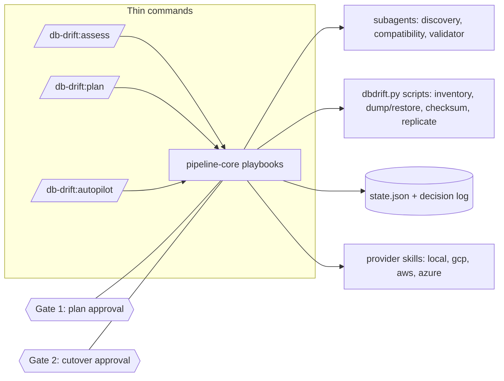

# db-drift

db-drift is an agentic pipeline for migrating an on-prem PostgreSQL
database to a cloud target. A thin set of slash commands drives a
deterministic state machine through seven phases, backed by scripts
that do every database-touching operation, with two mandatory human
approval gates before anything provisions or cuts over. Nothing about
the data plane is left to a model's judgment: row counts, checksums,
and object counts are computed by code and compared by code, not
eyeballed.

## Architecture



Each command is a thin router into `skills/pipeline-core`, which holds
the shared rules and the per-phase playbooks. A playbook dispatches a
subagent when the work needs judgment (reading a schema, weighing
compatibility, trying to break a finished migration) and calls a
script when the work needs to be exact (a dump, a checksum, a sequence
bump). Every phase transition and every gate decision is written to
`state.json` and appended to `decision-log.md` by the state CLI, never
by hand.

## The pipeline

| Phase | What it does | Artifact |
|---|---|---|
| init | Creates the migration workspace and records source connection details | `migration.yaml` |
| assess | Dispatches a discovery subagent to inventory the source and a compatibility subagent to check the target provider's capability matrix | `01-assessment.md`, `inventory.json`, `compatibility-notes.md` |
| plan | Chooses a strategy (dump_restore or logical_replication) by fixed rules, lists any source-side changes, and presents **Gate 1** | `02-plan.md` |
| provision | Creates the target instance, database, and roles via the configured provider | `03-provision.md`, `target.json` |
| migrate_schema | Dumps and restores the pre-data schema section, compares table/view/matview/sequence counts | `04-schema-report.md` |
| migrate_data | Moves the data (bulk restore or logical replication sync), refreshes materialized views, compares all object counts | `05-data-report.md` |
| validate | Dispatches an adversarial validator subagent: checksums, row counts, constraint and index counts, sample queries, matview counts | `06-validation.md` |
| cutover | Presents **Gate 2**, then quiesces the source, finalizes the sync, bumps target sequences, runs smoke queries | `07-cutover-runbook.md` |

## Quickstart

```
# install the plugin, then from the plugin root:
/db-drift:demo setup
/db-drift:init demo-run
/db-drift:autopilot
```

`/db-drift:demo setup` seeds a local "on-prem" PostgreSQL instance with
a 655,000-row retail schema (customers, products, orders, order_items,
audit_log, plus a view and a materialized view). `/db-drift:init`
writes the migration workspace. `/db-drift:autopilot` runs every phase
in order, pausing only at the two gates.

Real timing from the v0.1.0 acceptance run, 655,000 source rows,
target sized at 90 MB:

| Phase | Elapsed |
|---|---|
| assess (two subagents) | 3m 32s |
| provision | 18s |
| migrate_schema | 16s |
| migrate_data (logical replication sync) | 57s |
| validate (adversarial subagent) | 2m 4s |
| cutover | 39s |

Just under 8 minutes of pipeline execution across the six automated
phases. The plan phase's wall-clock time is not included above: it
ends at Gate 1, which waits on a human, by design, not on anything the
pipeline could speed up.

## Safety model

Five rules bind every phase, restated from `skills/pipeline-core/SKILL.md`:

1. **State is never hand-edited.** Every transition goes through the
   state CLI, which enforces legal transitions and appends to the
   decision log itself, so the log can't drift from what actually ran.
2. **The source is read-only**, enforced by the scripts, not by
   convention. The only writes ever permitted are the ones an approved
   plan explicitly lists: creating a publication and replication slot
   for logical replication, quiescing writes at cutover, and reverting
   that quiesce during a rollback.
3. **Secrets never appear in output.** Only environment variable names
   go into `migration.yaml`, artifacts, or anything printed; passwords
   and full connection URLs are never echoed.
4. **Gates run in the main session, never in a subagent.** A subagent
   can recommend a strategy or find a validation failure; only the main
   session can approve or decline a gate, and it must record the
   outcome before the pipeline moves on.
5. **A phase isn't complete until its playbook's verification step
   passed.** `start-phase` before work, `complete-phase` only after the
   phase's own checks pass, `fail-phase --reason` otherwise.

## Providers

Every provider skill implements the same contract: provision, connect,
teardown, and a cost line, so a playbook never branches on which cloud
it's talking to. `provider-local` is the demo stand-in: a second
portable PostgreSQL instance playing the role of the cloud target, with
the identical contract. `provider-gcp`, `provider-aws`, and
`provider-azure` document that same contract against Cloud SQL, RDS,
and Azure Database for PostgreSQL respectively, written from each
provider's own documentation. They are **not live-tested**: no phase of
this project ran a migration against a real GCP, AWS, or Azure account.
Treat them as a correct starting map of the API surface, not as
something to point at production without dry-running it first.

## What v1 does not do

- **MySQL execution.** `init` accepts `engine: mysql` and the provider
  skills note each cloud's MySQL flavor, but every execution script
  (dump, restore, checksum, replicate) is PostgreSQL-only in v1.
- **Heterogeneous migrations.** No engine-to-engine moves (Oracle to
  PostgreSQL and similar are out of scope).
- **Fully autonomous cutover.** Gate 2 always requires a human; there
  is no flag that skips it.
- **Live-tested cloud provisioning.** The GCP, AWS, and Azure provider
  skills are documentation-derived contracts, not exercised against
  real accounts.

## Development

```
db-drift/
├── .claude-plugin/plugin.json   plugin manifest
├── commands/                    one thin router per pipeline verb
├── agents/                      discovery, compatibility, and validator subagents
├── skills/
│   ├── pipeline-core/           shared rules and phase playbooks
│   ├── provider-local/          local demo stand-in provider
│   └── provider-{gcp,aws,azure}/  cloud provider contracts (not live-tested)
├── scripts/dbdrift.py           the CLI: pg, seed, inventory, dump, restore,
│                                 objcount, checksum, replicate, state
├── demo/scenario.md             the retail demo schema and seed spec
└── tests/                       unit tests for the scripts
```

Run the test suite:

```
python -m pytest -q
```

19 tests pass, covering the state machine's transition and gate
enforcement, checksum snapshot and diff, and inventory parsing.

The acceptance run that produced the numbers in this README was a real
execution of the whole pipeline against the demo environment: a fresh
on-prem instance seeded with `/db-drift:demo setup`, driven through
every phase with real subagent dispatches and both gates presented to
an actual operator, ending with a live cutover, a probe insert on the
target landing above the bumped sequence, and the source rejecting a
write. Its artifacts live under `sandbox/migrations/demo-run/artifacts/`
in the repository that produced this release.
